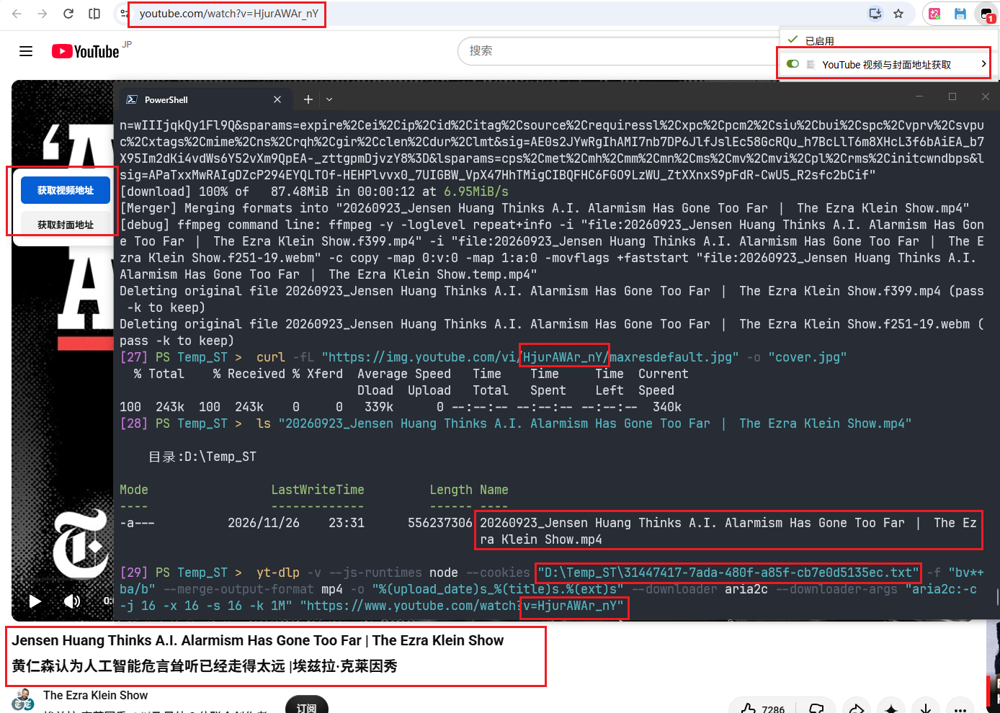

# my_download_from_u2b

个人使用：从u2b下载视频和封面，脚本获取链接，使用yt-dlp下载视频，默认下载最佳画质，用curl下载封面图片。

环境：

1.Win10 + Chrome（已安装插件：篡改猴，Get cookies.txt LOCALLY）

2.使用Scoop安装和管理软件，已安装 yt-dlp、curl、nodejs

建议：

先看“脚本--chrome中YouTube 视频与封面地址获取.md”，

再看“用curl来下载U2B封面图片.md”和“yt-dlp下载YouTuBe视频--win10.md”

效果：

