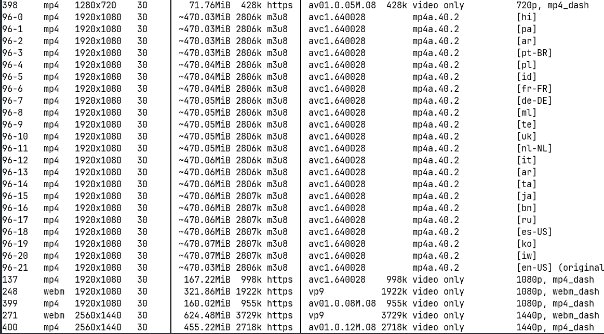

# yt-dlp下载YouTuBe视频--win10

//2026年11月26日


注：我在Chrome浏览器中使用插件，来获取youtube的cookies文件，导出前先打开并刷新一遍youtube网页（已登录）。

注：我使用scoop安装yt-dlp，同时安装了aria2

```
[9] PS D:\ >  yt-dlp --version
2026.11.23

[10] PS D:\ >  aria2c --version
aria2 version 1.37.0
Copyright (C) 2006, 2019 Tatsuhiro Tsujikawa
```


## 1.3个常用命令

文件默认保存在你执行命令时 PowerShell 所处的当前目录。

```
1.查看有哪些格式可用
yt-dlp --js-runtimes node --cookies "D:\Temp_ST\4bad3ebb-c9b7-4f28-998c-4be168cadeb4.txt" --list-formats "https://www.youtube.com/watch?v=MiAl9CNZUuo"

2.下载指定格式

3.下载最佳格式，指定下载名称,使用时先浏览器访问这个视频地址，登录油管账号，导出cookies文本文件，修改下面的cookies文件地址和视频的网址

yt-dlp -v --js-runtimes node --cookies "D:\Temp_ST\31447417-7ada-480f-a85f-cb7e0d5135ec.txt" -f "bv*+ba/b" --merge-output-format mp4 -o "%(upload_date)s_%(title)s.%(ext)s" --downloader aria2c --downloader-args "aria2c:-c -j 16 -x 16 -s 16 -k 1M" "https://www.youtube.com/watch?v=4e1bkPeMWX8"
```

注1：YouTube 通常会为同一个视频提供多种格式：

- 仅视频流：1080p、720p、480p 等。
- 仅音频流：M4A、WebM 等。
- 音视频合并流：部分分辨率可能同时包含音频和视频。
- 不同编码：AV1、VP9、H.264 等。

注：下载参数说明

### **下载参数说明**

| 参数                                              | 作用                                      |
| ------------------------------------------------- | ----------------------------------------- |
| `--js-runtimes node`                              | 使用 Node.js 解决 YouTube JavaScript 挑战 |
| `--cookies`                                       | 使用你的 YouTube 登录 Cookie              |
| `-f "bv*+ba/b"`                                   | 自动选择最佳视频和音频                    |
| `--merge-output-format mp4`                       | 合并为 MP4 容器                           |
| `-o "%(upload_date)s_%(title)s_[%(id)s].%(ext)s"` | 使用 YouTube 视频标题作为文件名           |

这样做有三个好处：

- 按日期排序，方便管理视频。
- 保留原始标题，方便搜索。
- 保留 YouTube 视频 ID，避免同名视频覆盖，也方便以后查找原视频。

**我的最终建议：使用第四节的命名模板，长期批量下载和整理 YouTube 视频会更加方便。**

## 2.登录验证

我使用导出cookies文本来使用。

yt-dlp 官方提供了使用浏览器 Cookie 的解决方案。

如果你使用 Chrome 浏览器登录了 YouTube，可以尝试：

```
yt-dlp --js-runtimes node --cookies-from-browser chrome --list-formats "https://www.youtube.com/watch?v=MiAl9CNZUuo"
```

这里：

- `--js-runtimes node`：使用 Node.js。
- `--cookies-from-browser chrome`：读取 Chrome 中的登录 Cookie。
- `--list-formats`：只查看格式，不实际下载。

注意：Cookie 相当于浏览器登录凭证，不要把导出的 Cookie 文件或 Cookie 内容发给别人，也不要上传到聊天窗口。

如果 Chrome Cookie 无法读取，可以先关闭 Chrome 再试。

## 3.youtube常见格式分析



这个视频提供了 1080p 和 1440p 两种分辨率。

### **一、分析当前可用格式**

你提供的格式中，主要有以下几种：

| 格式 ID | 分辨率 | 编码  | 类型       |
| ------- | ------ | ----- | ---------- |
| 96-21   | 1080p  | H.264 | 音视频合并 |
| 137     | 1080p  | H.264 | 仅视频     |
| 248     | 1080p  | VP9   | 仅视频     |
| 399     | 1080p  | AV1   | 仅视频     |
| 271     | 1440p  | VP9   | 仅视频     |
| 400     | 1440p  | AV1   | 仅视频     |

其中：

- **H.264（avc1）**：兼容性最好，适合 Windows 10 和常见播放器。
- **VP9**：YouTube 常用编码，画质与文件大小比较均衡。
- **AV1**：压缩效率较高，但对硬件解码能力要求相对较高。

另外，`96-21` 是英语原始音轨，其他 `96-*` 是不同语言的音轨版本。

### **二、推荐下载命令**

如果你希望下载最高画质，我建议：

**方案 A：1440p，优先 AV1**

```
yt-dlp --js-runtimes node --cookies "D:\Temp_ST\4bad3ebb-c9b7-4f28-998c-4be168cadeb4.txt" -f "400+ba/b" --merge-output-format mp4 "https://www.youtube.com/watch?v=MiAl9CNZUuo"
```

**方案 B：1440p，优先 VP9**

```
yt-dlp --js-runtimes node --cookies "D:\Temp_ST\4bad3ebb-c9b7-4f28-998c-4be168cadeb4.txt" -f "271+ba/b" --merge-output-format mp4 "https://www.youtube.com/watch?v=MiAl9CNZUuo"
```

**方案 C：1080p，兼容性优先**

```
yt-dlp --js-runtimes node --cookies "D:\Temp_ST\4bad3ebb-c9b7-4f28-998c-4be168cadeb4.txt" -f "137+ba/b" --merge-output-format mp4 "https://www.youtube.com/watch?v=MiAl9CNZUuo"
```

注意：`--merge-output-format mp4` 只指定合并后的容器格式，不会把 AV1 或 VP9 转码成 H.264。


## 4.声音和下载参数说明

```
-f "400+ba/b"
```

有声音。`400+ba/b` 的目的就是：**下载 1440p 视频画面，同时下载最佳音频，最后将两者合并成一个文件。**

### **拆解** `400+ba/b`

| 参数  | 含义                                           |
| ----- | ---------------------------------------------- |
| `400` | 下载格式 ID 为 400 的视频，即 1440p AV1 视频流 |
| `+`   | 将视频流和音频流组合下载                       |
| `ba`  | Best Audio，选择最佳音频流                     |
| `/`   | 如果前面的格式组合不可用，则尝试后面的格式     |
| `b`   | Best，选择最佳的单文件音视频格式               |

因此：

```
400+ba/b
```

实际上包含两种下载策略：

1. 优先下载 400（1440p AV1 视频）+ 最佳音频。
2. 如果无法实现这种组合，则退回到最佳单文件音视频格式。

### 补充：1440p 为什么需要单独下载音频？

YouTube 通常采用 DASH 技术，将视频和音频分开提供。

### 默认下载最佳画质和声音

如果你希望以后下载 YouTube 视频时自动选择最高画质并保留声音，不必每次手动指定格式，可以使用：

```
-f "bv*+ba/b"
```

它会自动选择最佳视频流和最佳音频流，而不是固定使用 1440p 的 Format 400。

## 5.调用外部下载器 aria2c

可以。yt-dlp 支持调用外部下载器 aria2c，并利用多线程、多连接下载来提高速度。

考虑到你使用的是 Windows 10、PowerShell，并且已经配置好 Cookie 和 Node.js，我建议在原来的命令上增加 aria2c 参数。

### **一、推荐的完整下载命令**

```
yt-dlp --js-runtimes node --cookies "D:\Temp_ST\你的cookies.txt" -f "bv*+ba/b" --merge-output-format mp4 --downloader aria2c --downloader-args "aria2c:-c -j 16 -x 16 -s 16 -k 1M" -o "%(upload_date)s_%(title)s_[%(id)s].%(ext)s" "https://www.youtube.com/watch?v=MiAl9CNZUuo"
```

### **二、aria2c 参数说明**

| 参数                  | 含义             | 说明                        |
| --------------------- | ---------------- | --------------------------- |
| `--downloader aria2c` | 使用 aria2c      | 指定外部下载器              |
| `-c`                  | 断点续传         | 支持继续下载未完成的文件    |
| `-j 16`               | 最大并行任务数   | 同时下载最多 16 个任务      |
| `-x 16`               | 最大服务器连接数 | 单个服务器最多 16 个连接    |
| `-s 16`               | 分段数量         | 将文件分成最多 16 段下载    |
| `-k 1M`               | 最小分段大小     | 小于 1MB 的分段不再继续拆分 |

这些参数是 aria2c 的参数，不是 yt-dlp 的参数。

官方文档：[yt-dlp 下载器配置](https://github.com/yt-dlp/yt-dlp?utm_source=chatgpt.com#download-options)。

### **三、一个重要问题：aria2c 不一定能加速所有格式**

你的命令：

```
-f "bv*+ba/b"
```

会优先下载最佳视频和最佳音频。

但 YouTube 提供的视频流有不同协议：

- HTTP/HTTPS：aria2c 可以接管。
- DASH：取决于具体下载协议和 yt-dlp 的下载器选择。
- HLS/m3u8：yt-dlp 通常使用原生或 FFmpeg 下载器，而不是 aria2c。

因此，不能认为添加 aria2c 后，所有视频流都会自动使用多线程下载。

### **四、如何确认 aria2c 是否真正生效？**

在命令中增加 `-v`：

```
yt-dlp -v --js-runtimes node --cookies "D:\Temp_ST\你的cookies.txt" -f "bv*+ba/b" --merge-output-format mp4 --downloader aria2c --downloader-args "aria2c:-c -j 16 -x 16 -s 16 -k 1M" "https://www.youtube.com/watch?v=MiAl9CNZUuo"
```

观察输出中是否出现类似：

```
[debug] Invoking aria2c downloader on ...
```

如果出现，说明 yt-dlp 确实调用了 aria2c。

### **五、我的额外建议**

不要盲目追求 16 连接。建议先使用：

```
-j 8 -x 8 -s 8 -k 1M
```

如果速度没有改善，再尝试 16 连接。

另外，YouTube 可能对并发请求进行限速，连接数越多不一定越快。

**最后提醒：** 如果你发现 aria2c 已经启动，但下载速度没有明显提升，可以尝试比较 yt-dlp 原生下载器与 aria2c 的实际速度。对于 YouTube，aria2c 并不保证一定比原生下载器快。

