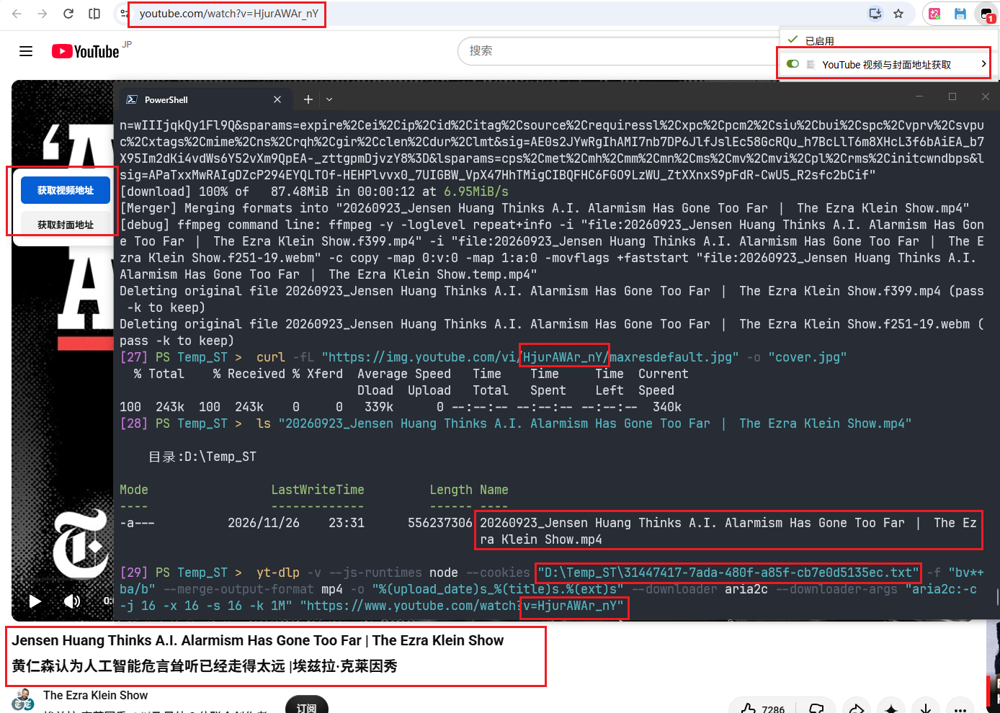

# 脚本--chrome中YouTube 视频与封面地址获取

//2026年11月26日




目的：获取视频和封面的下载地址

```
我使用chrome浏览器，需要一个脚本，在我打开youtube上某个视频网址时，我希望出现两个按钮，一个按钮是”获取视频地址“，另一个按钮是”获取封面地址“。让它们在当前网页的左侧位置出现，固定在当前网页的左侧中间偏上位置，而且窗口向下滚动时，它们的位置依然不变。其中，”获取视频地址“按钮，要做到的功能是，假如当前视频的网址为https://www.youtube.com/watch?v=-Qyd__IJIhg，那么点击这个按钮，要给我返回一个类似这样的内容，yt-dlp -v --js-runtimes node --cookies "D:\Temp_ST\31447417-7ada-480f-a85f-cb7e0d5135ec.txt" -f "bv*+ba/b" --merge-output-format mp4 -o "%(upload_date)s_%(title)s.%(ext)s" --downloader aria2c --downloader-args "aria2c:-c -j 16 -x 16 -s 16 -k 1M" "https://www.youtube.com/watch?v=-Qyd__IJIhg",并复制到剪贴板，以便我自己去powershell中粘贴内容后下载。另一个”获取封面地址“按钮的功能则是生成一个类似这样的内容，curl -fL "https://img.youtube.com/vi/-Qyd__IJIhg/maxresdefault.jpg" -o "cover.jpg",然后点击该按钮时，也会复制这个内容要剪贴板中。我的浏览器中使用篡改猴插件来安装脚本。
```

说明：1.我在Chrome浏览器中使用插件Get cookies.txt LOCALLY来导出当前cookies文本文件，我已经登录了youtube账号。保存为：D:\Temp_ST\31447417-7ada-480f-a85f-cb7e0d5135ec.txt，每次导出时，直接覆盖替换即可。不要改名字了。如果将来需要改cookies文件的名称或路径，则也要修改脚本中的内容。

2.我使用win10，用scoop已经按照了yt-dlp，aria2c，和curl。

**两个细节说明**

1. **Cookie 路径**：我按照你提供的路径进行了硬编码。如果以后 Cookie 文件位置发生变化，只需要修改脚本顶部的 `COOKIES_PATH`。
2. **封面清晰度**：目前使用 `maxresdefault.jpg`，即优先获取 YouTube 最高分辨率封面。不过，并非每个视频都提供这一尺寸；如果下载失败，可以尝试将 `maxresdefault.jpg` 改成 `hqdefault.jpg`。

另外，这个脚本不会自动下载任何视频或图片，只负责生成命令并复制到剪贴板。实际下载仍然由你在 PowerShell 中执行，完全符合你目前使用 yt-dlp 和 aria2c 的工作流程。

## 1.脚本内容

说明：

两个按钮改成**左侧固定悬浮工具栏**，不再插入 YouTube 原来的顶部导航栏，也不修改 YouTube 页面原有布局。

具体调整如下：

- 位置：网页左侧，距离左边缘 18px。
- 高度：距离浏览器内容区域顶部约 20%。
- 排列：两个按钮上下垂直排列。
- 固定定位：使用 `position: fixed`，页面向下滚动时位置不变。
- 样式：保留蓝色「获取视频地址」和灰色「获取封面地址」。
- 功能：保留原来的复制命令、复制成功提示、视频切换自动更新等功能。
- YouTube 原来的 Logo、搜索框、用户头像等元素完全不动。

### **位置调整方法**

以后如果你想改变按钮的位置，只需要修改配置区域的两个参数：

```
const LEFT_POSITION = '18px';
const TOP_POSITION = '20vh';
```

| 参数            | 作用                         |
| --------------- | ---------------------------- |
| `LEFT_POSITION` | 距离网页左边缘的距离         |
| `TOP_POSITION`  | 距离浏览器内容区域顶部的距离 |

例如：

- `LEFT_POSITION = '18px'`：距离左侧 18px。
- `TOP_POSITION = '20vh'`：距离顶部为浏览器可视高度的 20%。
- `TOP_POSITION = '150px'`：距离顶部固定 150px。

**我的建议是先保留 18px 和 20vh。** 这样两个按钮不会再占据 YouTube 顶部导航栏的空间，而且滚动网页时会一直固定在左侧。

### **安装方法**

1. 打开 Chrome 浏览器，点击 Tampermonkey 图标。
2. 选择「添加新脚本」。
3. 删除编辑器中的默认内容。
4. 粘贴上面的完整代码。
5. 按 `Ctrl + S` 保存。
6. 打开任意 YouTube 视频页面，刷新网页。

```

// ==UserScript==
// @name         YouTube 视频与封面地址获取
// @namespace    https://www.youtube.com/
// @version      3.0.0
// @description  在 YouTube 页面左侧添加固定悬浮下载工具栏
// @author       User
// @match        https://www.youtube.com/*
// @grant        GM_setClipboard
// @run-at       document-idle
// ==/UserScript==

(function () {
    'use strict';

    // ========================================
    // 一、配置区域
    // ========================================

    const COOKIES_PATH =
        'D:\\Temp_ST\\31447417-7ada-480f-a85f-cb7e0d5135ec.txt';

    const COVER_FILENAME = 'cover.jpg';

    const TOOLBAR_ID = 'my-youtube-download-toolbar';

    // 工具栏位置
    const LEFT_POSITION = '18px';
    const TOP_POSITION = '20vh';

    // ========================================
    // 二、获取当前视频 ID
    // ========================================

    function getVideoId() {
        const url = new URL(location.href);

        if (url.pathname === '/watch') {
            return url.searchParams.get('v');
        }

        const match = url.pathname.match(
            /^\/(?:shorts|live)\/([^/?]+)/
        );

        return match ? match[1] : null;
    }

    // ========================================
    // 三、生成视频下载命令
    // ========================================

    function generateVideoCommand(videoId) {
        const videoUrl =
            `https://www.youtube.com/watch?v=${videoId}`;

        return `yt-dlp -v --js-runtimes node --cookies "${COOKIES_PATH}" -f "bv*+ba/b" --merge-output-format mp4 -o "%(upload_date)s_%(title)s.%(ext)s" --downloader aria2c --downloader-args "aria2c:-c -j 16 -x 16 -s 16 -k 1M" "${videoUrl}"`;
    }

    // ========================================
    // 四、生成封面下载命令
    // ========================================

    function generateCoverCommand(videoId) {
        const coverUrl =
            `https://img.youtube.com/vi/${videoId}/maxresdefault.jpg`;

        return `curl -fL "${coverUrl}" -o "${COVER_FILENAME}"`;
    }

    // ========================================
    // 五、复制到剪贴板
    // ========================================

    function copyCommand(command, button, originalText) {
        try {
            GM_setClipboard(command, 'text', function () {
                button.textContent = '已复制！';
                button.classList.add('success');

                setTimeout(() => {
                    button.textContent = originalText;
                    button.classList.remove('success');
                }, 1500);
            });
        } catch (error) {
            console.error('[YouTube工具] 复制失败：', error);
            alert('复制失败，请检查 Tampermonkey 权限。');
        }
    }

    // ========================================
    // 六、创建左侧固定悬浮工具栏
    // ========================================

    function createToolbar() {

        const videoId = getVideoId();

        // 非视频页面，移除工具栏
        if (!videoId) {
            document.getElementById(TOOLBAR_ID)?.remove();
            return;
        }

        // 已经存在完整工具栏，不重复创建
        const existing = document.getElementById(TOOLBAR_ID);

        if (
            existing &&
            existing.shadowRoot?.querySelectorAll('button').length === 2
        ) {
            return;
        }

        // 清理旧工具栏
        existing?.remove();

        // 创建悬浮容器
        const toolbar = document.createElement('div');

        toolbar.id = TOOLBAR_ID;

        // 使用 fixed 固定在浏览器视口中
        toolbar.style.cssText = `
            position: fixed !important;
            left: ${LEFT_POSITION} !important;
            top: ${TOP_POSITION} !important;
            width: auto !important;
            height: auto !important;
            min-height: 0 !important;
            padding: 0 !important;
            margin: 0 !important;
            z-index: 2147483647 !important;
            display: block !important;
            background: transparent !important;
            border: none !important;
            box-shadow: none !important;
            pointer-events: auto !important;
        `;

        // 创建 Shadow DOM，隔离 YouTube 页面样式
        const shadow = toolbar.attachShadow({
            mode: 'open'
        });

        // 工具栏样式
        const style = document.createElement('style');

        style.textContent = `
            .toolbar {
                display: flex;
                flex-direction: column;
                align-items: stretch;
                gap: 10px;
                padding: 10px;
                background: #ffffff;
                border: 1px solid #e5e5e5;
                border-radius: 10px;
                box-shadow: 0 3px 12px rgba(0, 0, 0, 0.15);
                font-family: Arial, sans-serif;
            }

            button {
                display: flex;
                align-items: center;
                justify-content: center;
                box-sizing: border-box;
                width: 124px;
                height: 38px;
                padding: 0 10px;
                border: none;
                border-radius: 6px;
                font-size: 13px;
                font-weight: 600;
                cursor: pointer;
                white-space: nowrap;
                transition: background 0.2s;
            }

            .video {
                background: #065fd4;
                color: #ffffff;
            }

            .video:hover {
                background: #044eae;
            }

            .cover {
                background: #f2f2f2;
                color: #0f0f0f;
            }

            .cover:hover {
                background: #e5e5e5;
            }

            button.success {
                background: #188038;
                color: #ffffff;
            }
        `;

        // 创建工具栏主体
        const container = document.createElement('div');

        container.className = 'toolbar';

        // 视频下载按钮
        const videoButton = document.createElement('button');

        videoButton.className = 'video';
        videoButton.textContent = '获取视频地址';
        videoButton.type = 'button';

        videoButton.addEventListener('click', () => {
            const currentId = getVideoId();

            if (!currentId) {
                alert('无法获取当前视频 ID。');
                return;
            }

            copyCommand(
                generateVideoCommand(currentId),
                videoButton,
                '获取视频地址'
            );
        });

        // 封面下载按钮
        const coverButton = document.createElement('button');

        coverButton.className = 'cover';
        coverButton.textContent = '获取封面地址';
        coverButton.type = 'button';

        coverButton.addEventListener('click', () => {
            const currentId = getVideoId();

            if (!currentId) {
                alert('无法获取当前视频 ID。');
                return;
            }

            copyCommand(
                generateCoverCommand(currentId),
                coverButton,
                '获取封面地址'
            );
        });

        // 添加按钮
        container.appendChild(videoButton);
        container.appendChild(coverButton);

        shadow.appendChild(style);
        shadow.appendChild(container);

        // 直接添加到 body，不修改 YouTube 导航栏
        document.body.appendChild(toolbar);

        console.log(
            '[YouTube工具] 左侧悬浮工具栏创建成功：',
            videoId
        );
    }

    // ========================================
    // 七、监听页面导航
    // ========================================

    function updateToolbar() {
        createToolbar();
    }

    // 初次加载
    updateToolbar();

    // YouTube 内部导航
    document.addEventListener(
        'yt-navigate-finish',
        updateToolbar
    );

    // 浏览器前进和后退
    window.addEventListener(
        'popstate',
        updateToolbar
    );

    // 监听 DOM 变化
    const observer = new MutationObserver(() => {
        if (
            getVideoId() &&
            !document.getElementById(TOOLBAR_ID)
        ) {
            createToolbar();
        }
    });

    observer.observe(document.documentElement, {
        childList: true,
        subtree: true
    });

    // 处理页面延迟加载
    let retryCount = 0;

    const retryTimer = setInterval(() => {
        createToolbar();

        retryCount++;

        if (
            document.getElementById(TOOLBAR_ID) ||
            retryCount >= 20
        ) {
            clearInterval(retryTimer);
        }
    }, 500);

    console.log('[YouTube工具] v3.0.0 启动成功。');

})();

```


## 2.打开执行用户脚本的权限

chrome浏览器中，打开扩展程序，找到篡改猴，点击进”详情“，找到并启用 **"允许用户脚本"切换开关**。

注：**A209** 对于在基于 Chrome 的浏览器中使用 Tampermonkey 扩展（版本 5.3+）的用户，必须启用 **"允许用户脚本"切换开关**（在 Chrome 138+ 中可通过扩展设置找到）或 **开发者模式**。

### 为什么需要执行用户脚本的权限？

由于用户脚本的两步授权过程，需要额外的权限：`userScripts` 权限和切换开关或开发者模式。 仅有 `userScripts` 权限在安装时不会触发用户警告，反映了 Google 确保用户在运行使用用户脚本的扩展时做出明智决定的意图。